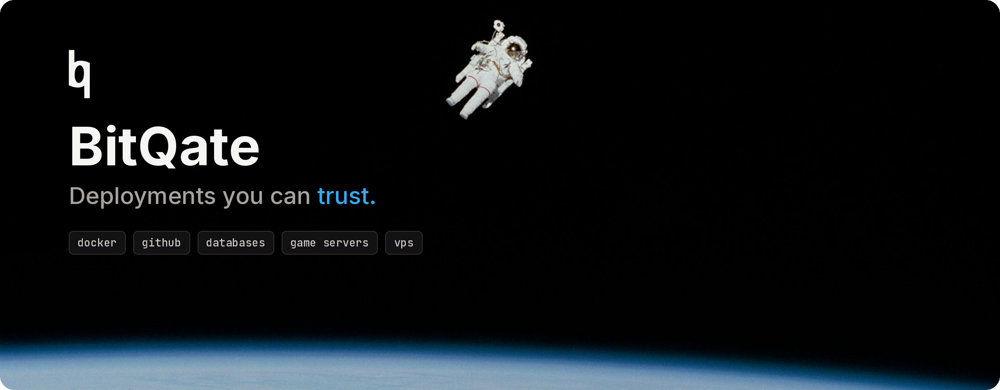

  

  Hosting for containers, repositories, databases, game servers and VPSes. 
  Paid per resource, from a prepaid balance. No plan tiers.

  <a href="https://www.bitqate.com">Website</a> ·
  <a href="https://portal.bitqate.com/register">Portal</a> ·
  <a href="https://status.bitqate.com">Status</a>

---

### What runs on BitQate

| Deployment | What you get |
| --- | --- |
| **Docker image** | Any image from Docker Hub or GHCR, env vars, extra volume mounts |
| **GitHub repository** | Continuous deploys on every commit, with guided Dockerfile setup |
| **Database** | PostgreSQL, Redis, MySQL, MongoDB, each with its own management UI |
| **Game server** | Minecraft, Valheim and other egg-based games |
| **VPS** | Full virtual machine from an OS template |

Every container gets a live browser console. Every deployment gets IPv6; IPv4 is optional.

---

  
    Something down? Check <a href="https://status.bitqate.com">status.bitqate.com</a>.
    Need help? Open a ticket in the <a href="https://portal.bitqate.com/tickets">portal</a> or write to <a href="mailto:support@bitqate.com">support@bitqate.com</a>.
  

